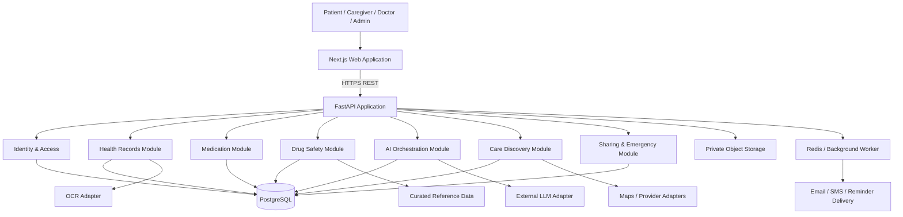
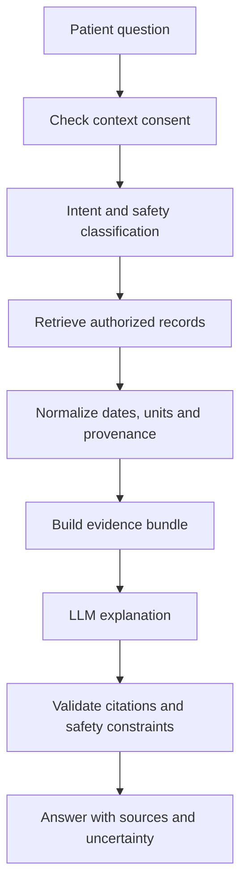

# System Architecture

## 1. Architecture decision

Use a **modular monolith** with a separately deployed web frontend and API backend. Do not start with microservices. A solo developer needs clear module boundaries without distributed-system overhead.

## 2. High-level architecture



## 3. Technology choices

| Layer | Choice | Reason |
|---|---|---|
| Web | Next.js + TypeScript | Mature React framework, routing and typed UI |
| UI | Tailwind + shadcn-compatible components | Consistent tokens and reusable patterns |
| API | FastAPI | Typed Python API and OpenAPI |
| Validation | Pydantic | Input/output schemas |
| ORM | SQLAlchemy 2.x | Explicit relational modelling |
| Migrations | Alembic | Versioned schema changes |
| DB | PostgreSQL | Relational integrity and JSONB where justified |
| Jobs | Redis + Celery | Reminders, OCR and report tasks |
| AI | Provider-neutral adapter | Avoid hard vendor lock-in |
| OCR | Adapter around PaddleOCR or provider | Replaceable extraction implementation |
| Maps | OSM-compatible provider | Geographic discovery |
| Files | Private object storage | Protect prescriptions and reports |
| Tests | Pytest, Vitest, Playwright | Unit, API and browser coverage |
| Runtime | Docker Compose | Reproducible development |

## 4. Backend module boundaries

```text
backend/app/
  core/              # config, security, logging, errors
  api/               # versioned routers and dependencies
  identity/          # users, sessions, OAuth, OTP
  patients/           # profiles, conditions, allergies, consent
  records/            # documents, observations, lab results
  medications/        # catalogue, medication statements, schedules
  reminders/          # notification generation and delivery
  safety/             # interactions, warnings, ADR
  assistant/          # context retrieval, prompts, citations
  discovery/          # pharmacies, doctors, appointments
  nutrition/          # diet preferences and educational plans
  sharing/            # consent grants, access logs, PDF summaries
  emergency/          # emergency contacts and ambulance adapter
  admin/              # catalogue and reference-data administration
  integrations/       # external provider adapters
  workers/            # background tasks
  tests/
```

Each module owns its schemas, service layer and repository/data-access functions. Cross-module calls should go through service interfaces, not import another module's private internals.

## 5. Frontend boundaries

```text
frontend/
  app/
    (auth)/
    (patient)/
    (caregiver)/
    (doctor-share)/
    admin/
  components/
    ui/
    layout/
    health/
    medications/
    records/
    safety/
    assistant/
    discovery/
    emergency/
  features/
  lib/
    api-client.ts
    auth.ts
    formatters.ts
    permissions.ts
  hooks/
  types/
```

The frontend is not an authorization boundary. Every API request must enforce permissions.

## 6. Data flow rules

- Browser → API over HTTPS.
- API → database using least-privileged service credentials.
- Browser never connects directly to PostgreSQL or Redis.
- Uploaded documents go to private storage; API issues short-lived signed access only after authorization.
- Background workers receive identifiers, not broad copies of patient data.
- External AI receives minimum necessary context and no direct identifiers unless strictly required and consented.
- External integrations are isolated behind adapters with timeouts, retries and circuit-breaker behaviour where appropriate.

## 7. AI and retrieval architecture



AI must not query the database with arbitrary generated SQL. The backend exposes narrow retrieval tools such as:
- `get_current_medications(patient_id, as_of)`
- `get_medication_timeline(patient_id, medicine_id)`
- `get_lab_observations(patient_id, test_code, date_range)`
- `get_conditions(patient_id)`
- `get_allergies(patient_id)`
- `get_recent_vitals(patient_id)`

Every tool performs authorization and returns only required fields.

## 8. Reminder architecture

- Schedule records are authoritative.
- A worker generates due reminder events.
- Use idempotency keys to prevent duplicate notifications.
- Store intended local timezone and schedule rule.
- Delivery status is separate from dose status.
- Notification sent does not mean dose taken.
- Patient action creates a dose log.
- Retry delivery safely without creating duplicate dose records.

## 9. External integration adapters

Define interfaces, not provider-specific logic inside business services:

- `EmailProvider`
- `SmsOtpProvider`
- `GoogleOAuthProvider`
- `DrugReferenceProvider`
- `MedicineVerificationProvider`
- `PharmacyInventoryProvider`
- `DoctorDirectoryProvider`
- `AppointmentProvider`
- `AmbulanceDispatchProvider`
- `MapsProvider`
- `OcrProvider`
- `LlmProvider`
- `SpeechProvider`

Each adapter returns source metadata and explicit unsupported/unavailable states.

## 10. Deployment

Development Compose:
- frontend
- backend
- postgres
- redis
- worker
- optional mail catcher

Production:
- reverse proxy / TLS termination
- frontend
- backend
- worker
- PostgreSQL managed or secured service
- Redis private network
- private object storage
- monitoring and backups

Only reverse proxy ports should be public. Do not expose database or Redis ports publicly.

## 11. Architecture Decision Records

### ADR-001: Modular monolith
Accepted. Microservices add deployment and debugging complexity without benefit at this scale.

### ADR-002: PostgreSQL as source of truth
Accepted. Health records and medication data require relational integrity and auditability.

### ADR-003: Separate clinical reference data from patient-entered data
Accepted. A patient statement is not the same as a verified clinical reference.

### ADR-004: AI is an explanation layer, not the clinical rules engine
Accepted. Safety decisions must be based on curated, versioned data and validated logic.

### ADR-005: Provider integrations are replaceable
Accepted. Inventory, doctor, ambulance and medicine verification integrations may be unavailable during academic development.

### ADR-006: Same-origin proxy with cookie sessions and bound CSRF tokens
Accepted (Phase 1). The browser only talks to the Next.js origin; `/api/v1/*` is proxied to FastAPI.
Session cookies are therefore first-party and no CORS is needed. Sessions are opaque random tokens
(SHA-256 hashed at rest), `HttpOnly`, `SameSite=Lax`, `Secure` in production. State-changing
authenticated requests require an `X-CSRF-Token` equal to an HMAC bound to the session (returned by
`/auth/login`, `/auth/register`, `/auth/me`), and any unsafe request with a non-allowed `Origin` is
rejected. Sessions rotate on login and on email verification and are all revoked on password reset.

### ADR-007: Consent ledger drives onboarding state
Accepted (Phase 1). `user_consents` is append-only; the current state is the latest row per type.
"Onboarding complete" is derived (terms + privacy + health-data processing granted) rather than
stored, so withdrawing a required consent returns the patient to onboarding without extra state.

### ADR-008: Soft removal of patient-reported clinical entries
Accepted (Phase 1). Conditions and allergies are never hard-deleted; patients mark them
`entered_in_error`, which hides them by default but preserves history (DATABASE.md principle).
Editing the content of a confirmed entry resets it to `patient_reported`. Emergency contacts are
not clinical history and are hard-deleted.

### ADR-009: Assistant answers only from retrieved evidence
Accepted (Phase 5). Retrieval is fixed, owner-scoped code gated by the `ai_context` consent and per-chat switches; the model has no tools, SQL or memory and receives de-identified, escaped evidence. Safety-critical behaviour is outside the model: pre-model policy for urgent/treatment/diagnosis requests, post-model validation (citations, numbers, advice and causal claims) with fallback to the plain records, and server-added disclaimers. No evidence means no model call. Consequence: answers are less fluent than a free-form chatbot, by design.

### ADR-010: Evidence-only mode is first class
Accepted (Phase 5). `LLM_PROVIDER=none` is the default and a supported configuration, so the demo works offline and a provider outage degrades to listing records rather than failing. The provider sits behind `LLMProvider` (ADR-005).

## 12. Operational requirements

- `/health/live` and `/health/ready` endpoints.
- Structured logs with request IDs.
- Never log passwords, OTPs, tokens, report contents or full health chat messages.
- Database migrations run as a controlled deployment step.
- Encrypted backups and tested restore process.
- Dependency and container scanning in CI.
