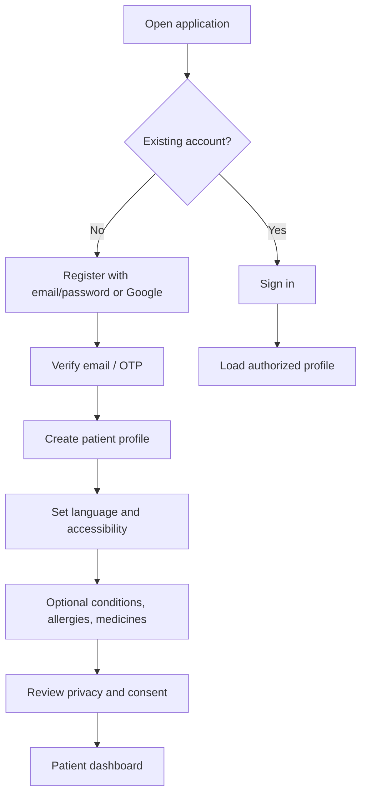
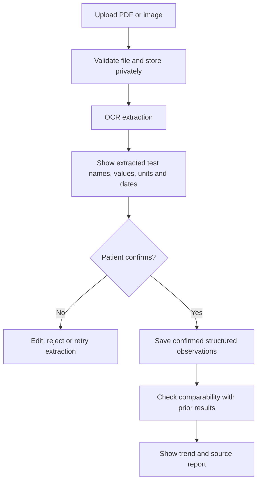
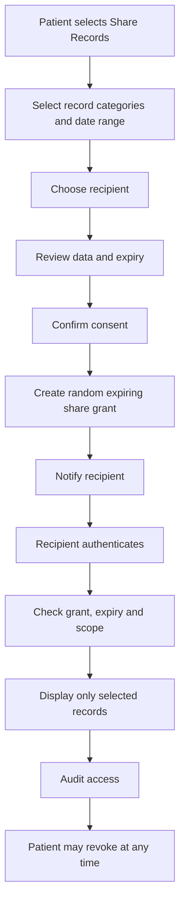

# Product Workflows

## 1. Registration and onboarding

Rules:
- OTP expires and is single-use.
- Google OAuth identity must be linked safely.
- Sensitive onboarding questions are optional unless needed for a feature.
- User can skip and complete later.

## 2. Add medicine and create reminder

1. Patient searches catalogue or enters medicine manually.
2. Selects matching product and strength.
3. Records whether it came from a prescription or patient report.
4. Enters prescribed instructions exactly as written; the app does not generate dosage.
5. Sets schedule and timezone.
6. Reviews and confirms.
7. Worker schedules reminder occurrences.
8. Patient receives notification.
9. Patient marks taken, skipped, delayed or unknown.
10. Dose log is stored with scheduled and recorded timestamps.

Important:
- Notification delivery is not dose confirmation.
- The app must not advise doubling a missed dose.
- A medicine being listed does not prove it is currently being taken.

## 3. Upload laboratory report and confirm extracted values

Rules:
- Keep original document.
- OCR result is unconfirmed until review.
- Store report-specific reference ranges.
- Do not infer diagnosis from an out-of-range result.

## 4. Ask AI about medicine and test-result trends

1. Patient opens AI assistant.
2. UI shows context controls.
3. Patient asks a question.
4. Backend checks identity, consent and ownership.
5. Intent classifier selects relevant retrieval tools.
6. Backend retrieves medication timeline and comparable test results.
7. Evidence bundle includes dates, values, units, source and verification state.
8. LLM generates an explanation.
9. Validator checks patient-specific claims against evidence.
10. UI shows answer with source links and limitations.

Example question:
"Has my HbA1c improved since I started this medicine?"

Response should separate:
- Observed test-value trend.
- Recorded medication timeline.
- Dose/adherence data availability.
- Unknown/confounding factors.
- What cannot be concluded.

Never tell the patient to start, stop or change a medicine.

## 5. Drug interaction check

1. Patient selects current medicines.
2. Backend resolves products to active ingredients.
3. Engine checks ingredient pairs against curated rules.
4. Engine checks condition/allergy/food rules where data exists.
5. Results grouped by severity and evidence source.
6. Missing rule returns "No matching record in this dataset" or "Insufficient data".
7. Patient is directed to pharmacist/prescriber for interpretation.

## 6. Medicine expiry and authenticity workflow

1. Patient scans package or enters batch details.
2. OCR/barcode extracts candidate fields.
3. Patient confirms medicine, batch and expiry.
4. Expiry engine creates reminders.
5. Verification adapter queries authoritative source if available.
6. Result is verified, mismatch, suspicious for review or unable to verify.
7. App explains that scan success alone is not authenticity proof.

## 7. Generic alternative and price comparison

1. User selects a medicine.
2. Resolve active ingredients, strength, dosage form and release type.
3. Search catalogue for candidates.
4. Filter out non-comparable formulations.
5. Retrieve price/pack data with source timestamp.
6. Show per-pack and normalized unit comparison where possible.
7. Label candidates and require professional confirmation before substitution.

## 8. Pharmacy discovery

1. User grants location or enters area manually.
2. Search nearby pharmacy directory.
3. Show map/list, distance, address and contact.
4. If inventory provider feed exists, display stock with last updated time.
5. If no feed exists, show "Call to confirm availability".
6. Do not invent availability or price.

## 9. Doctor discovery and appointment

1. Patient searches specialty/location.
2. Filter provider directory.
3. Show credentials with verification status and source.
4. Patient selects provider.
5. Appointment request goes to integrated provider or is marked as request-only.
6. Confirmation is displayed only after provider response.

## 10. Share medical history with doctor

## 11. Emergency assistance and ambulance

- SOS opens a clear emergency panel.
- User can call configured emergency services.
- Location sharing is permission-based.
- Emergency summary is previewed and shared only through an authorized workflow.
- If ambulance provider integration is unavailable, show the simulated workflow label.
- Simulated booking must never be confused with a real dispatch.
- Real dispatch requires provider acceptance before showing confirmed status.

## 12. Caregiver workflow

- Patient invites caregiver.
- Patient selects permissions and duration.
- Caregiver accepts invitation.
- Caregiver can perform only delegated actions.
- Patient can inspect and revoke access.
- Caregiver actions are attributed to caregiver identity.

## 13. Admin data-curation workflow

- Admin imports or edits a reference record.
- Source, licence, jurisdiction and version are required.
- Safety rule includes severity, evidence and reviewed date.
- Second-person review is preferred for safety-critical changes.
- Publish creates a new version; previous version remains auditable.
- Admin changes do not silently rewrite patient history.
